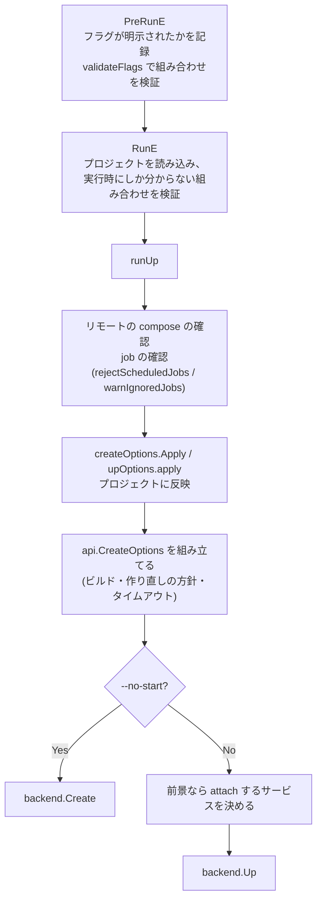

[root](../../note.md) / [cmd](../note.md) / [compose](note.md) / up.go

読んでいて出た疑問の Q&A は [up.go-qa.md](up.go-qa.md)。

# cmd/compose/up.go

`docker compose up` のコマンド定義。
フラグを `upOptions` / `createOptions` / `buildOptions` の 3 つに詰め、組み合わせを検証してから、`api.UpOptions` に変換して `backend.Up` を呼ぶ。

## 全体の流れ

## upOptions のフィールド

`composeOptions`(`up` と `run` で共通のプロジェクト指定)を埋め込み、`up` だけのフラグを持つ。

| 分類 | フィールド | フラグ | 意味 |
| ---- | ---------- | ------ | ---- |
| 起動の仕方 | `Detach` | `-d` | バックグラウンドで起動する |
| | `noStart` | `--no-start` | 作るだけで起動しない |
| | `noDeps` | `--no-deps` | 依存サービスを起動しない |
| | `wait` / `waitTimeout` | `--wait` / `--wait-timeout` | running / healthy になるまで待つ(`-d` を含む)/ その上限の秒数 |
| | `watch` | `-w` | ファイルの変更を監視して、ビルドし直す・同期する |
| 終了のさせ方 | `cascadeStop` | `--abort-on-container-exit` | どれか 1 つが止まったら全部止める |
| | `cascadeFail` | `--abort-on-container-failure` | どれかが失敗で止まったら全部止める |
| | `exitCodeFrom` | `--exit-code-from` | 指定したサービスの終了コードを `up` 全体の終了コードにする |
| ログの表示 | `attach` / `noAttach` | `--attach` / `--no-attach` | ログを表示する / しないサービスを指定する |
| | `attachDependencies` | `--attach-dependencies` | 依存サービスのログも表示する |
| | `noColor` / `noPrefix` / `timestamp` | `--no-color` / `--no-log-prefix` / `--timestamps` | 白黒にする / サービス名の前置きを消す / 時刻を付ける |
| メニュー | `navigationMenu` | `--menu` | 前景で動いている間のキーボード操作を有効にする |
| | `navigationMenuChanged` | — | `--menu` が明示されたかどうか |

## 関数

### upOptions.apply

- `--no-deps` のとき、指定したサービスだけにプロジェクトを絞る(依存を無視する)
- `--exit-code-from` のサービスが存在するかを確かめる

### upOptions.resolveNavigationMenu

メニューを有効にするかを、次の順で決める。

1. 出力先が端末でなければ無効
2. `--menu` が明示されていれば、その値
3. 環境変数 `COMPOSE_MENU` があれば、その値
4. どれも無ければ有効

### upOptions.OnExit

cascade のフラグを API の定数に変換する。コンテナが終わったときに、ほかのコンテナをどうするかを決める。

| 定数 | 条件 | 動き |
| ---- | ---- | ---- |
| `CascadeStop` | `--abort-on-container-exit` | どれか 1 つが終わったら全部止める。テストやバッチで便利 |
| `CascadeFail` | `--abort-on-container-failure` | 失敗で終わったときだけ全部止める。正常終了なら続ける |
| `CascadeIgnore` | 上のどちらでもない | ほかのコンテナはそのまま動き続ける |

### upCommand

cobra のコマンドを定義し、フラグを 3 つのオプション構造体に結び付ける。

- **PreRunE**: `--pull` / `--timeout` / `--menu` が明示されたかを記録する。`--remove-orphans` が無ければ環境変数 `COMPOSE_REMOVE_ORPHANS` を見る。最後に `validateFlags` を呼ぶ
- **RunE**: プロジェクトを読み込んだ後でしか分からない組み合わせを検証する(`COMPOSE_IGNORE_ORPHANS` と `--remove-orphans`、`--attach` と `--attach-dependencies`、サービスが 1 つも選ばれていない)。メニューの有効・無効を決めて `runUp` を呼ぶ
- `--y` は誤って入ったフラグ名で、警告を出して `--yes` に読み替える

### validateFlags

フラグの組み合わせを検証し、ほかのフラグから決まる値を補う。

- **補う**: `--exit-code-from` は `--abort-on-container-exit` を含む。`--wait` は `-d` を含む
- **同時に使えない組み合わせ**:
  - `--abort-on-container-exit` と `--abort-on-container-failure`
  - `--build` と `--no-build`、`--no-build` と `--watch`
  - `-d`(または `--wait`)と、`--abort-on-*`・`--attach`・`--attach-dependencies`・`--watch`
  - `--no-recreate` と、`--force-recreate`・`--always-recreate-deps`・`--renew-anon-volumes`
- `--wait-timeout` が負の数ならエラー

### runUp

フラグをプロジェクトと API のオプションに反映し、backend に依頼する本体。

1. リモートの compose ファイルを使っていれば確認を取る(`checksForRemoteStack`)
2. job を確かめる。スケジュールつきの job があればエラー、手動の job は起動しない旨を警告する
3. `createOptions.Apply` と `upOptions.apply` をプロジェクトに反映する
4. `--no-build` でなければ、ビルドのオプションを作る(対象は作るサービス全部。`--no-deps` なら依存を除く)
5. `api.CreateOptions` を組み立てる(作り直しの方針、匿名ボリュームを引き継ぐか、停止のタイムアウトなど)
6. `--yes` なら、確認のプロンプトを常に yes にする
7. `--no-start` なら `backend.Create` で終わる
8. 前景で動くなら、ログを表示するサービスを決める
   - `--attach` があればそれを使う(`up` の対象に無いサービスならエラー)
   - 無ければ、対象のサービスのうち compose ファイルで `attach: false` にしていないもの。`--attach-dependencies` なら依存も含む
   - 最後に `--no-attach` のサービスを除く
9. `backend.Up` を呼ぶ。メニューは、有効で、かつ進捗表示が plain でなく、入力が端末のときだけ出す

### warnIgnoredJobs / rejectScheduledJobs

`up` は job を起動しない。そのための確認。

- `rejectScheduledJobs`: スケジュールつきの job があれば、黙って無視すると期待を裏切るので、エラーにして止める
- `warnIgnoredJobs`: 手動の job は `docker compose run` で起動するものなので、起動しない旨を警告するだけ
