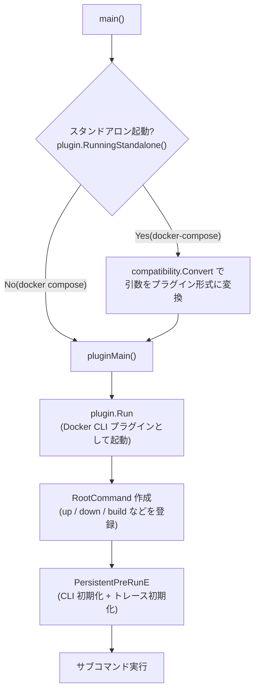

[root](../note.md) / [cmd](note.md) / main.go

# cmd/main.go

`docker compose` / `docker-compose` のエントリーポイント。
Compose の cobra ルートコマンドを組み立て、Docker CLI プラグインとして実行する。

## 全体の流れ

## 関数

### main

- 起動の仕方を判定して、`pluginMain` を呼ぶだけ
- プラグインモード(`docker compose ...`)
  - Docker CLI から呼び出される。引数はそのまま使う
- スタンドアロンモード(`docker-compose ...`)
  - 旧 v1 との互換のための起動形態
  - `compatibility.Convert` で引数を `docker compose ...` の並びに組み替え、先頭に `docker` を足す

### pluginMain

`plugin.Run` に次の 3 つを渡して、Docker CLI プラグインとして起動する。

| 引数 | 内容 |
| ---- | ---- |
| コマンド生成関数 | `command.Cli` を受け取り、ルートコマンド(`*cobra.Command`)を返す |
| `metadata.Metadata` | プラグインのメタデータ(スキーマバージョン、ベンダー、バージョン) |
| `command.WithUserAgent` | API リクエストの User-Agent を `compose/<バージョン>` にする |

コマンド生成関数の中でやっていること:

1. **backendOptions を組み立てる**
   - Compose の backend(`pkg/compose`)に渡す `compose.Option`
   - y/n 確認プロンプト(`WithPrompt`)と、キーボード操作のナビゲーションメニュー(`WithNavigationMenu`)を差し込む
2. **ルートコマンドを作る**
   - `commands.RootCommand` で全サブコマンドを登録し、`HooksCommand` も追加する
3. **PersistentPreRunE を上書きする**(全サブコマンドの実行前に必ず走るフック)
   - `plugin.PersistentPreRunE` で CLI を初期化する(入出力、Docker コンテキスト、daemon への接続)
   - `cmdtrace.Setup` でトレースを有効化する。失敗しても debug ログを出すだけで止まらない
   - 元の `PersistentPreRunE` があれば最後に呼ぶ
4. **SetFlagErrorFunc を設定する**
   - フラグのエラーを Docker CLI と同じ `StatusError`(終了コード 1)に揃える
