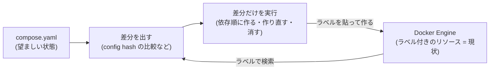

# Compose が動く仕組み

Compose が「どうやって compose.yaml どおりの環境を作り、保つのか」を、1 つの例を最後まで追って説明する。
用語や細部はリンク先に任せ、ここでは流れだけを掴む。

← [document 一覧](../README.md)

## 1. なぜ Compose か

Web アプリを動かすには、アプリ本体・DB・ネットワーク・ボリュームを用意し、DB を先に起動して……と、
`docker run` などを正しい順番で何本も打つ必要がある。止めるとき・設定を変えるときも同じだけ手間がかかり、消し忘れや作り直し忘れが起きる。

Compose は、必要なリソースと依存関係を **compose.yaml に「どうあってほしいか」として宣言**し、
`docker compose up` の 1 コマンドでその状態にする。手順を書く(命令的)のではなく、結果を書く(宣言的)。
→ 具体的な `docker run` との比較は [intro.md §2, §3](./intro.md#2-なぜ-docker-だけでは足りないのか)

## 2. Compose は自分で状態を持たない

ここが仕組みの要。Compose は「前回何を作ったか」を記録するファイルやデータベースを持たない。
代わりに、**作ったリソースすべてにラベルを貼り、Docker Engine 自体を状態の保管場所にする**。

- 「どのプロジェクトのものか」「どのサービスのものか」「どの設定で作ったか」をラベルとして付ける
- 次に実行したときは、ラベルで絞り込んで「自分が管理しているもの」を見つけ出す
- だから CLI を何度起動し直しても、別の端末から実行しても、ラベルさえ読めれば現状が分かる

あとは毎回「compose.yaml(望ましい状態)」と「ラベルで見つけた現状」を比べ、**差分だけを埋める**。これを以下の例で追う。

## 3. 例で追う

ディレクトリ `myapp/` に次の compose.yaml があるとする。プロジェクト名はディレクトリ名から `myapp` になる。

```yaml
services:
  web:
    image: myapp-web
    environment:
      LOG_LEVEL: info
    depends_on:
      - db
  db:
    image: postgres:16
    volumes:
      - db-data:/var/lib/postgresql/data

volumes:
  db-data:
```

### 場面 1: 初めての `docker compose up -d`

1. **現状を調べる**: ラベル `com.docker.compose.project=myapp` で Docker Engine を検索する。何も見つからない
2. **差分を出す**: 望ましい状態は「ネットワーク 1 つ、ボリューム 1 つ、コンテナ 2 つ」。現状は空なので、全部が作る対象になる
3. **実行する**: 依存関係の順に作る。ネットワークとボリューム → `db` → `db` に依存する `web`

作られたコンテナを `docker inspect myapp-web-1` で見ると、Compose が貼ったラベルがある(抜粋)。

```
com.docker.compose.project=myapp
com.docker.compose.service=web
com.docker.compose.container-number=1
com.docker.compose.config-hash=3f9a...      ← web の設定から計算したハッシュ
com.docker.compose.depends_on=db:service_started:false
com.docker.compose.project.config_files=/path/to/myapp/compose.yaml
```

ネットワーク `myapp_default` やボリューム `myapp_db-data` にも、同じように `project` と `network`/`volume` のラベルが付く。
コンテナ名 `myapp-web-1` もラベルから組み立てたものだが、Compose が頼りにするのは名前ではなくラベルのほう。

### 場面 2: 設定を変えてもう一度 `up -d`

`web` の `LOG_LEVEL` を `debug` に変えて、もう一度 `docker compose up -d` を打つ。

1. **現状を調べる**: ラベルで検索すると、`myapp-web-1` と `myapp-db-1`、ネットワーク、ボリュームが見つかる
2. **差分を出す**: サービスごとに、今の compose.yaml から config hash を計算し、コンテナのラベル `config-hash` と比べる
   - `db`: 設定は変わっていないのでハッシュが一致する → 何もしない
   - `web`: `environment` が変わったのでハッシュが違う → 作り直す
3. **実行する**: `web` だけを作り直す。新しいコンテナを一時的な名前で作ってから、古いものを止めて消し、新しいものを正式な名前に変える。
   新しいものを作れなかった場合は、古いものがそのまま残る

これが「`up` は何度打っても安全」な理由。正しく動いているもの(`db`)には触れず、変わったもの(`web`)だけが入れ替わる。
何を変えると作り直しになるか(例: `depends_on` の変更はハッシュに入らない)は [compose-lifecycle.md](./compose-lifecycle.md#5-作り直しrecreateの判定) を参照。

### 場面 3: `docker compose down`

1. **現状を調べる**: ここでも compose.yaml の中身ではなく、ラベル `project=myapp` で消す対象を探す。
   そのため、compose.yaml がない場所でも `docker compose -p myapp down` で片付けられる
2. **実行する**: 依存の逆順に止めて消す。`web` → `db` の順にコンテナを消し、最後にネットワークを消す
   - ボリューム `myapp_db-data` は、データを守るため `-v` を付けたときだけ消える

## 4. まとめ



- Compose は状態を持たず、**ラベルを通して Docker Engine 上の現状を読む**
- 毎回「望ましい状態」と「現状」を比べて**差分だけを埋める**(収束処理)
- 作る・消す順番は `depends_on` から作った**依存グラフ**で決まる

## 次に読むもの

- 概念の詳細: [compose-concepts.md](./compose-concepts.md)(ラベル、収束処理、依存グラフ)、[compose-lifecycle.md](./compose-lifecycle.md)(depends_on、作り直しの判定、ラベル一覧)
- 実装での姿: [codebase/plan-engine.md](../codebase/plan-engine.md)(観測 → 計画 → 実行)、[codebase/flow.md](../codebase/flow.md)(コマンドごとの処理の流れ)
