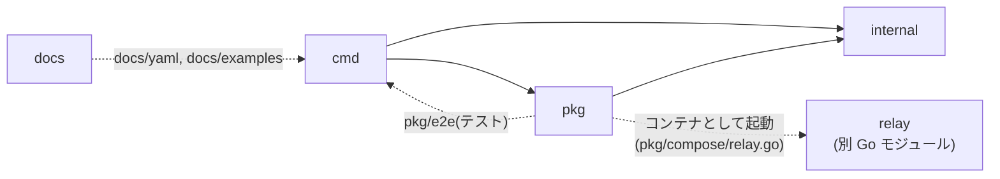
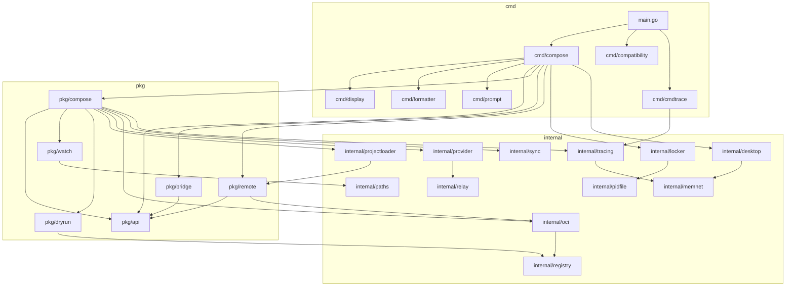

root

# コードノート入口

Compose の実装をディレクトリ・ファイル単位で言語化したノートの入口。
各ディレクトリの `note.md` が子ディレクトリの `note.md` / ファイルの `xxx.go.md` へリンクし、
各ノート先頭のパンくずから上の階層へ戻れる。ノート未作成の要素はリンクなしのプレーンテキストで書く。

概念・全体設計などの横断的な解説は [document/README.md](document/README.md) を参照。
コマンドを打ってからコンテナが起動するまでの処理の流れは [document/codebase/flow.md](document/codebase/flow.md) を参照。

## 依存関係

`go list` の import から集計したもの。矢印は「import する側 → される側」。

### ルートディレクトリ単位

本番コードは `cmd → pkg → internal` の一方向。点線はテスト/ドキュメント生成からの依存と、import ではない実行時の関係。

### 主要パッケージ単位

`cmd/compose` が `pkg/api` 経由で `pkg/compose` を呼び、`pkg/compose` が `internal` の部品を使う構造。
テスト用(`pkg/e2e`, `pkg/mocks`)と `pkg/utils` への依存は省略。

## ディレクトリ

- .github
  - GitHub 設定
- [cmd](cmd/note.md)
  - CLI 層(エントリーポイント)。cobra コマンド定義、進捗表示・出力フォーマット、トレース初期化、スタンドアロン互換
  - フラグを `*Options` に詰め替えて `pkg/api.Compose`(実体は `pkg/compose`)を呼ぶ薄いラッパー
- docs
  - ドキュメント
- [internal](internal/note.md)
  - 外部公開しない内部パッケージ群。Docker Desktop 連携、PID ファイルによる多重起動防止、OCI レジストリ操作、トレーシングなど
- [pkg](pkg/note.md)
  - Compose の本体(公開パッケージ)。公開 API(`pkg/api`)とその実装(`pkg/compose`)、watch・bridge・remote・dry-run・e2e テストなど
- [relay](relay/note.md)
  - `provider:` 型サービスを Compose ネットワークに見せる TCP ゲートウェイ `compose-relay`(独立した Go モジュール)

## ファイル

- .dockerignore
  - Docker ビルド時に無視するファイル
- .gitattributes
  - Git 属性の設定
- .gitignore
  - Git で追跡しないファイル/ディレクトリ
- .go-version
  - 使用する Go のバージョン
- .golangci.yml
  - コード品質チェックツール
- AGENTS.md
  - AI コーディングエージェント用のドキュメント
- BUILDING.md
  - ビルド方法の詳細説明
- codecov.yml
  - コードカバレッジ測定
- CONTRIBUTING.md
  - 貢献者向けのガイドライン
- docker-bake.hcl
  - Docker Buildx の設定ファイル
- Dockerfile
  - Docker Compose のバイナリをビルドする
- go.mod
  - Go モジュールの依存関係管理
- go.sum
  - Go モジュールの依存関係管理
- LICENSE
  - Apache License 2.0 のライセンス
- logo.png
  - Docker Compose のロゴ画像
- Makefile
  - ビルド、テスト、リリースなどの主要なコマンドを定義
- NOTICE
  - 著作権表示
- README.md
  - プロジェクトの概要説明
