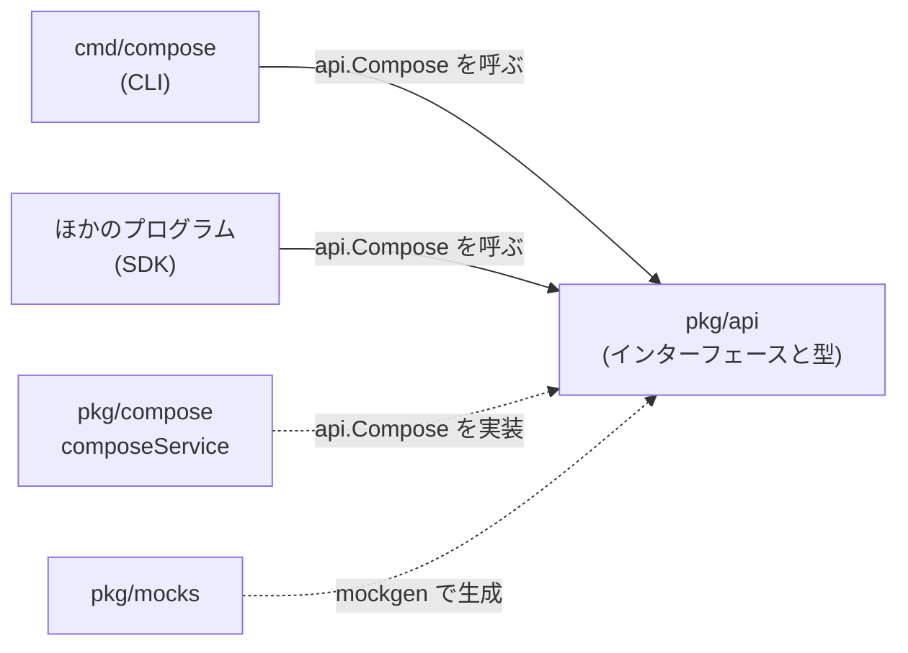

[root](../../note.md) / [pkg](../note.md) / api

# pkg/api

Compose の**公開 API の「型」だけを集めたパッケージ**。実装は持たない。
`cmd/compose` やほかのプログラム(SDK として使う人)は、このパッケージの `Compose` インターフェースを通して Compose を操作する。実装の本体は [pkg/compose](../compose/note.md) の `composeService`。

## 位置づけ

- このパッケージが依存するのは compose-go の型や moby の API の型などの外部のものと、`internal`(バージョンの文字列)だけ。`pkg/compose` には依存しないので、実装を差し替えられる(テストのモックなど)

## ファイル

| ファイル | 中身 | 主な使われ方 |
| -------- | ---- | ------------ |
| [api.go](api.go.md) | `Compose` インターフェースと、各操作の `XxxOptions` / 結果の型(918 行。このパッケージのほぼ全部) | `cmd/compose` がフラグを `XxxOptions` に詰めて `Compose` のメソッドを呼ぶ |
| [event.go](event.go.md) | 進捗のイベント(`Resource`、状態 `Working` / `Done` / `Warning` / `Error`、状態の文字列 `Creating` / `Started` など)と、それを受け取る `EventProcessor` | `pkg/compose` がイベントを出し、`cmd/display` が画面に描く |
| [labels.go](labels.go.md) | compose がコンテナなどに付けるラベルの名前(`com.docker.compose.project` / `.service` / `.config-hash` など) | どのコンテナがどのプロジェクトのものかを、ラベルで見分ける |
| errors.go | 共通のエラー(`ErrNotFound`、`ErrCanceled` など 9 個)と、判定の関数(`IsNotFoundError` など) | `errors.Is` で種類を判定する |
| [context.go](context.go.md) | `ContextInfo`。今の Docker コンテキストの名前、サーバーの OS、BuildKit が有効か | `pkg/compose` が受け取る(`WithContextInfo`) |
| feature.go | `Feature`(`Start` / `Stop` だけのインターフェース) | 前景の `up` でキー操作から watch を切り替えるのに使う(`cmd/formatter/shortcut.go`) |
| env.go | 環境変数の名前 `COMPOSE_COMPATIBILITY` だけ | `cmd/compose` が参照する |

テスト(`api_test.go`、`errors_test.go`、`labels_test.go`)は省略。

## Compose インターフェースの中身

`Compose` は、用途ごとの 6 つの小さなインターフェースを束ねたもの(`api.go:102-109`)。

| インターフェース | メソッド | 用途 |
| ---------------- | -------- | ---- |
| `Lifecycle` | Create / Start / Restart / Stop / Up / Down / Kill / Pause / UnPause / Scale / Remove / Wait | リソースを作る・動かす・変える・消す |
| `Inspector` | Ps / List / Top / Ports / Images / Volumes / Events / Logs / Viz | 状態を見る |
| `ImageManager` | Build / Push / Pull / Publish | イメージを扱う |
| `Runner` | RunOneOffContainer / Exec / Attach / Copy / Export / Commit | コンテナの中で何かをする |
| `Watcher` | Watch | 開発中のファイルの同期・再ビルド |
| `ProjectLoader` | LoadProject / Generate | compose ファイルや既存のコンテナからプロジェクトを作る |

### 読むときの注意

- **メソッドは、受け取ったプロジェクト全体に対して動く**。一部のサービスだけを対象にしたいときは、呼ぶ前にプロジェクト自体を絞る(`WithSelectedServices` など)(`api.go:95-101`)
- いくつかの `XxxOptions` にある `Services` フィールドは、**絞り込みのためのものではない**。利用者が名前を挙げたサービスを示すだけで、作り直しの方針やログの範囲など、付随することにだけ使う
