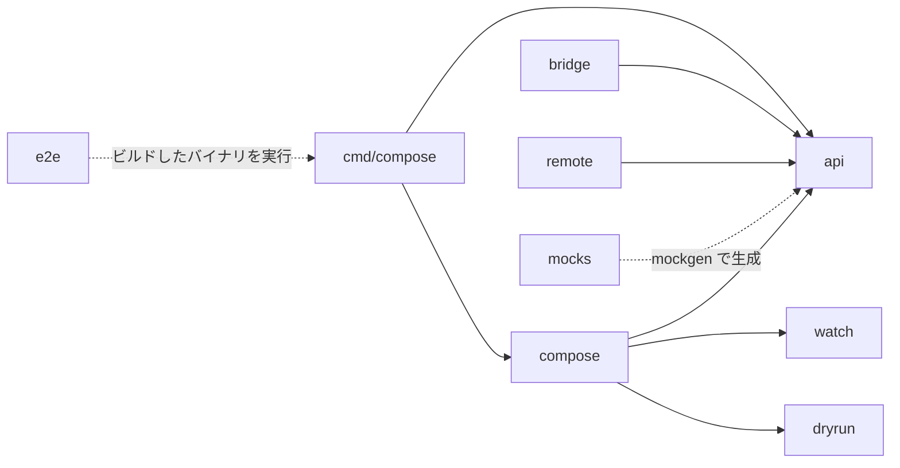

[root](../note.md) / pkg

# pkg

Compose の本体(外部からも import できる公開パッケージ)。
`cmd/compose` は `pkg/api` のインターフェースを通して `pkg/compose` を呼ぶ。それ以外は、本体が使う周辺機能とテスト用のパッケージ。

## 依存関係

`go list` の import から集計したもの。矢印は「import する側 → される側」。`internal/` への依存と `utils` への依存は省略。

## ディレクトリ

### 本体

| パッケージ | 役割 |
| ---------- | ---- |
| [api](api/note.md) | 公開インターフェース。`Compose` インターフェース(Up / Down / Ps など)と、Options・イベント・エラーの定義だけを持ち、実装は持たない |
| [compose](compose/note.md) | `api.Compose` の実装本体(`composeService`)。pkg で最大(テストを除いて 62 ファイル)。各ファイルは `cmd/compose` の同名のコマンドとほぼ 1 対 1 で対応する。`up` は観測 → 計画 → 並列実行の 3 段構成 |

### 周辺機能

| パッケージ | 役割 |
| ---------- | ---- |
| [bridge](bridge/note.md) | `docker compose bridge`。プロジェクトを Kubernetes の manifest などの別形式に変換する。変換は「transformer イメージ」をコンテナとして動かして行い、その雛形の生成と一覧も持つ |
| [remote](remote/note.md) | git リポジトリや `oci://` に置いた compose ファイルを取得するローダーと、そのキャッシュ先の管理 |
| watch | `docker compose watch` の中核。OS ごとのファイル監視、変更をまとめる debounce、`.dockerignore` の判定 |
| dryrun | `--dry-run` の実装。`client.APIClient` を丸ごと実装した `DryRunClient` が、Docker Engine に何も送らずに結果だけ組み立てて返す |
| utils | 小さなヘルパー。ジェネリクスの `Set[T]`、スレッドセーフな `SafeBuffer`、行ごとに分ける `Writer` など |

### テスト用

| パッケージ | 役割 |
| ---------- | ---- |
| e2e | End-to-End テスト。ビルドしたバイナリを本物の Docker daemon に対して実行して確かめる。`scenario.go` の宣言的な DSL(compose のモデル + 手順の列)と、`checks.go` の確認の語彙でできている |
| mocks | テスト用のモック。`mockgen` で `pkg/api` のインターフェースから自動生成する |
